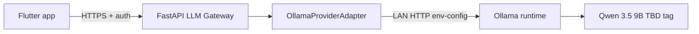
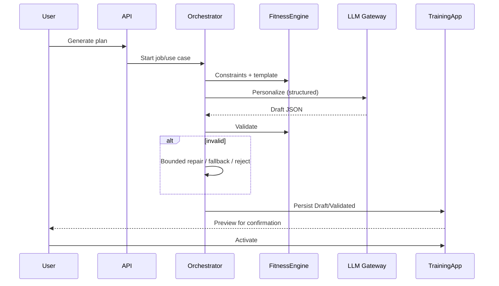
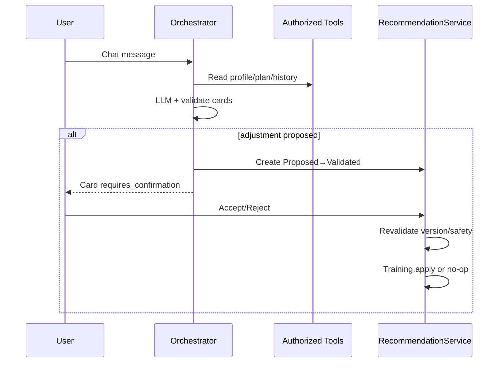

# Hybrid AI Coach Architecture

| Field | Value |
| --- | --- |
| Owner | Engineering (AI Systems) |
| Version | 0.2 |
| Status | `PROPOSED` (PH00-M02) + **Zero-Cost / Local AI First** (ADR-0017 `ACCEPTED`) |
| Related | AUTH-002 AIR-001..012, AUTH-003 §4 (amended by CR-20261125), ADR-0012/0017, PH00-TB-008 |
| Dev provider | **Ollama** (primary); initial POC model **Qwen 3.5 9B** (tag/capabilities **unverified**) |
| Pending | Model suitability / production readiness; eval dataset (M05/M08); any paid provider (PO approval required) |

## 1. Components

| Component | Responsibility |
| --- | --- |
| AI Orchestrator | Single lightweight pipeline coordinator (not multi-agent) |
| Request Normalizer | Auth context, locale, channel (chat/card/job) |
| Intent Router | Deterministic intents vs conversational vs hybrid |
| Context Builder | Assemble allowlisted context from SoT + memory |
| Safety Guardrails | Pre/post checks (pain, extremes, injection) |
| Tool Registry | Allowlisted tools only |
| Tool Authorization | Server-side scope by user id; never trust model user id |
| Fitness Engine | Deterministic validation/selection |
| LLM Gateway | Provider abstraction (ADR-0012) |
| Ollama Provider Adapter | **Primary** Phase 0 adapter — HTTP to configured Ollama base URL (unimplemented in M02; design only) |
| Other cloud adapters | **Not implemented** without PO approval (zero-cost constraint) |
| Structured Output Validator | Schema + allowlisted cards/actions |
| Recommendation Service | Proposal lifecycle |
| Memory Service | CRUD memory with provenance |
| Evaluation Hooks | Capture for offline eval |
| Usage Monitor | Tokens/cost/latency metadata |

## 2. Request lifecycle

1. Authenticate & authorize
2. Classify intent (optional)
3. Build context from **current authoritative** records + eligible memory
4. Safety/eligibility gates
5. Execute approved **read** tools / deterministic calculations
6. LLM generate (if needed) **or** deterministic response
7. Validate structured output
8. Domain + safety validation (Fitness Engine for plans)
9. Return message + allowlisted cards/actions
10. Material changes require explicit confirmation
11. Apply via **Training/Profile application services** (not LLM)
12. Audit + usage metadata

## 3. Hard enforcements

- No LLM direct DB access
- No arbitrary tools / endpoints
- No autonomous plan activation or goal changes
- Approved exercise IDs only
- No diagnosis; abnormal pain → safety guidance
- Memory ≠ domain truth
- No cross-user context leakage
- Fitness Engine is final safety authority for plan validity
- **Mobile never calls Ollama directly** — only authenticated FastAPI
- **Ollama not exposed** to public internet
- **No hardcoded** LAN addresses/model names in source — env config only
- **No paid AI APIs** without explicit PO approval

## 3b. Ollama deployment boundary

Reported base URL for ops docs only (not source): `http://192.168.8.54:11434`. Verify model tag and API capabilities before M05 implementation.

## 4. Capability availability

| Surface | AI behavior |
| --- | --- |
| Onboarding | Hybrid plan generation → draft → confirm |
| Today | Cards from validated recommendations; light chat |
| Pre-workout | Deterministic guidance + optional tips |
| During workout | **Deterministic only** — no per-set LLM |
| Post-workout | Feedback interpretation → optional proposal |
| Adaptive coaching | Proposal cards requiring accept/reject |
| Coach chat | Conversational + tools; streaming text; delayed actions |

## 5. Plan generation sequence

## 6. Chat / recommendation sequences

Provider failure: retry/timeout; serve deterministic fallback; workouts remain available; transparent quota.

## 7. Response contract (conceptual)

Allowlisted `cards[].type` and `actions[].type` only. Flutter renders allowlist. Example shape in AUTH-003. No executable code or raw URLs as actions.

## 8. Memory model

Types: conversation span, validated preferences, derived performance summaries, transient feedback, AI summaries.
Fields: provenance, timestamps, status, confidence, retention.
User view/edit/delete. Deleting memory ≠ deleting workouts.

## 9. Validation (PH00-M05 — local model)

Evaluate Ollama/Qwen for: structured JSON; JSON Schema adherence; plan generation; exercise ID grounding; tool-calling **or** app-controlled routing fallback; context handling; memory extraction; safety; Vietnamese + English quality; TTFT; total latency; tokens/sec; context growth; concurrency; CPU/GPU/RAM; timeout/recovery.

**Do not fabricate benchmarks.** If gaps remain, document and evaluate **zero-cost** alternatives before any paid proposal. Production readiness stays **PENDING**.
