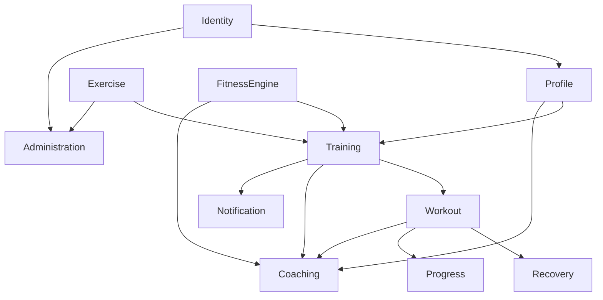

# Bounded Contexts — Core MVP

| Field | Value |
| --- | --- |
| Owner | Engineering (Architect) |
| Version | 0.1 |
| Status | `PROPOSED` (PH00-M02) |
| Related | AUTH-003 §2–3, PH00-TB-008 |

## Design principle

Prefer fewer contexts over premature fragmentation. Technology (SQLite, LLM, FCM) does **not** create a context by itself.

## Context catalogue

### 1. Identity

| | |
| --- | --- |
| Purpose | Authenticated principal, devices, consents, account deletion |
| Owns | User, ConsentRecord, DeviceRegistration (logical), account deletion requests |
| Aggregates | User (root) |
| Public APIs | Register/login via IdP; get me; delete account; manage consents |
| Depends on | External IdP (proposed) |
| Publishes | `user.deletion_requested`, `user.deleted` |
| Consumes | — |
| Security | AuthN, session/token validation, deletion authorization |
| Excludes | Profile fitness attributes; workouts |

### 2. Profile

| | |
| --- | --- |
| Purpose | Personal fitness profile, goals, preferences, assessments, limitations |
| Owns | UserProfile, FitnessGoal, UserPreference, FitnessAssessment, HealthLimitation |
| Aggregates | UserProfile (root) linked to User id |
| Public APIs | Get/update profile; set goals; record assessment; manage preferences/limitations |
| Depends on | Identity (user id) |
| Publishes | `profile.updated`, `goals.updated` |
| Consumes | `user.deleted` |
| Security | Owner-only writes; sensitive health-adjacent fields classified |
| Excludes | Plans, workouts, AI memory summaries as SoT |

### 3. Exercise Catalog

| | |
| --- | --- |
| Purpose | Approved exercise content |
| Owns | Exercise, MuscleGroup, Equipment, instructions/media refs, SubstitutionGroup, ContentReviewStatus |
| Aggregates | Exercise (root) |
| Public APIs | Search/list approved exercises; admin review workflow |
| Depends on | Administration (review actors) |
| Publishes | `exercise.approved`, `exercise.retired` |
| Consumes | — |
| Security | Public read of approved; admin write; licensing pending |
| Excludes | User plans; AI free-text inventing exercises |

### 4. Training

| | |
| --- | --- |
| Purpose | Plans, versions, days, planned exercises, activation, adjustments |
| Owns | TrainingPlan, TrainingPlanVersion, TrainingDay, PlannedExercise, PlanAdjustmentProposal |
| Aggregates | TrainingPlan (root); versions immutable once activated/superseded |
| Public APIs | Generate draft; validate; activate; propose/apply adjustment; get active |
| Depends on | Profile, Exercise Catalog, Fitness Engine (domain service) |
| Publishes | `training.plan_activated`, `training.plan_updated` |
| Consumes | `profile.updated` (invalidate stale proposals — app policy) |
| Security | Owner-only; confirmation for activation/material adjust |
| Excludes | Live workout execution logs |

### 5. Fitness Engine (domain service, not separate deployable)

| | |
| --- | --- |
| Purpose | Deterministic selection, templates, validation, safety constraints |
| Owns | No durable user aggregates — pure domain service / policies |
| Public APIs | Validate plan; select eligible exercises; schedule policy; substitution |
| Depends on | Exercise Catalog (read), Profile (read via args) |
| Publishes | — (returns validation results) |
| Consumes | — |
| Notes | Embedded in Training/Coaching application flows |

### 6. Workout

| | |
| --- | --- |
| Purpose | Session execution, sets, feedback, history, offline sync ingress |
| Owns | WorkoutSession, WorkoutExercise, WorkoutSet, WorkoutFeedback |
| Aggregates | WorkoutSession (root); references immutable TrainingPlanVersion id |
| Public APIs | Start/complete/abandon; sync events; history |
| Depends on | Training (version ref), Profile (owner) |
| Publishes | `workout.completed` |
| Consumes | `training.plan_activated` (schedule awareness via app) |
| Security | Owner-only; idempotent sync; account isolation |
| Excludes | Plan authoring |

### 7. Recovery

| | |
| --- | --- |
| Purpose | Post-workout / check-in recovery signals (MVP-basic) |
| Owns | RecoveryCheckIn (and workout-linked soreness via feedback bridge) |
| Aggregates | RecoveryCheckIn |
| Public APIs | Submit check-in |
| Depends on | Workout, Profile |
| Publishes | `recovery.checkin_recorded` |
| Consumes | `workout.completed` |
| Notes | Advanced recovery suite deferred (V1.5) |

### 8. Progress

| | |
| --- | --- |
| Purpose | Derived progress views, body measurements, PRs if P1 authorized |
| Owns | BodyMeasurement; ProgressSnapshot (read model); PR records if enabled |
| Aggregates | BodyMeasurement; ProgressSnapshot is projected |
| Public APIs | Record weight; get summary |
| Depends on | Workout (events), Profile |
| Publishes | — |
| Consumes | `workout.completed` |
| Notes | Derived metrics are **not** SoT for workouts |

### 9. Coaching (AI)

| | |
| --- | --- |
| Purpose | Conversations, messages, structured memory, recommendations |
| Owns | Conversation, Message, MemoryItem, Recommendation, AIUsageRecord |
| Aggregates | Conversation; Recommendation; MemoryItem |
| Public APIs | Chat SSE; list/edit/delete memory; accept/reject recommendation |
| Depends on | Profile, Training, Workout, Fitness Engine, LLM gateway |
| Publishes | `recommendation.accepted` (then Training applies) |
| Consumes | Profile/training/workout reads via tools — **no direct repos** |
| Security | Tool authZ; no cross-user context; no LLM DB writes |
| Excludes | Direct plan mutation without Training application service |

### 10. Notification

| | |
| --- | --- |
| Purpose | Preferences and reminder scheduling |
| Owns | NotificationPreference; scheduled reminder jobs (logical) |
| Public APIs | Update preferences |
| Depends on | Identity, Training (schedule) |
| Publishes | — |
| Consumes | `training.plan_activated`, `training.plan_updated` |
| Excludes | Marketing blast platform |

### 11. Administration

| | |
| --- | --- |
| Purpose | Minimal admin: users view, catalog review, AI usage, config |
| Owns | AdminRole bindings; configuration entries |
| Public APIs | Admin-only endpoints |
| Depends on | Identity, Exercise, Coaching (usage read) |
| Security | RBAC + MFA target; audit |

### 12. Platform (cross-cutting)

Jobs/Outbox, AuditRecord, AIUsage metering adapters — infrastructure services, not a business context. Used by others via application ports.

## Context map

**No cycles** among business contexts. Coaching depends inward on Training/Profile/Workout via application interfaces, not reverse.

## Explicit non-contexts (MVP)

Nutrition, Subscription/Billing, Social, Wearables integrations — deferred modules; do not create empty contexts.
