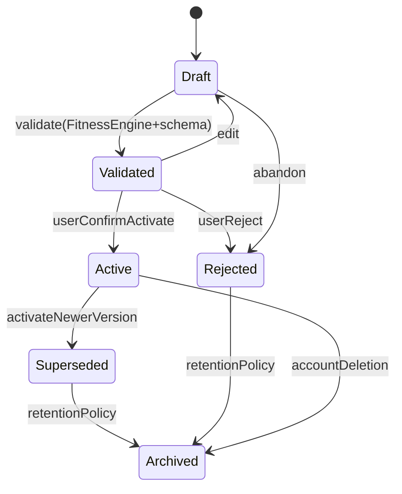
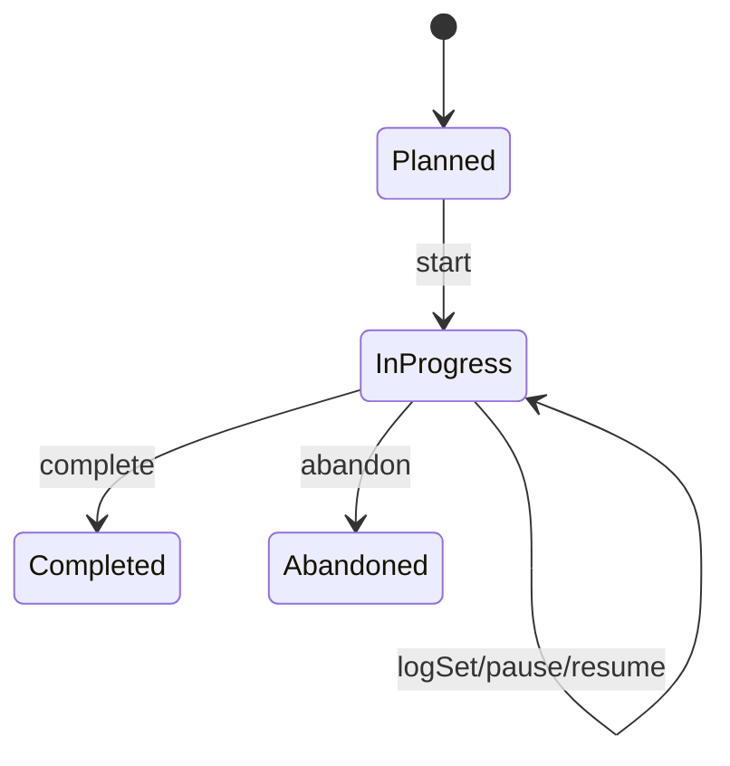
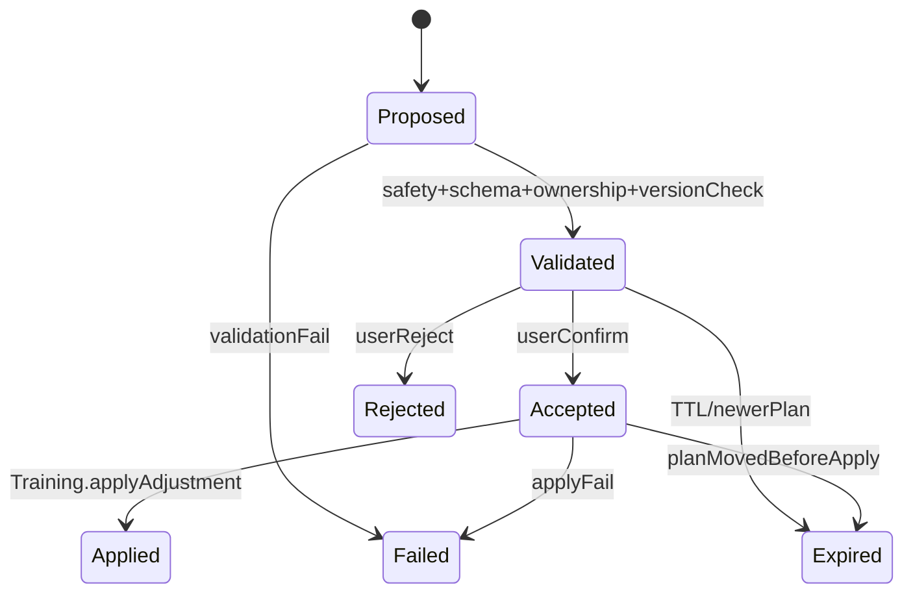

# Domain Lifecycles & State Models

| Field | Value |
| --- | --- |
| Owner | Engineering (Architect) |
| Version | 0.1 |
| Status | `PROPOSED` (PH00-M02) |
| Related | AUTH-003 §3–5, AIR-001..012 |

## 1. Training plan & version

**Split:** `TrainingPlan` holds pointer to `activeVersionId`. Lifecycle richness lives on `TrainingPlanVersion`.

### Version states

`Draft` → `Validated` → `Active` → `Superseded` → `Archived`
`Draft`/`Validated` → `Rejected`
`Rejected` → `Archived`

| Transition | Actor | Preconditions | Result | Invalid |
| --- | --- | --- | --- | --- |
| validate | System/User | Draft; schema OK; FitnessEngine pass; approved exercise IDs | Validated | Stay Draft + errors |
| activate | User | Validated; authZ owner; no conflicting in-flight activate | Version Active; previous Active → Superseded **atomically** | 409/reject |
| reject | User | Draft/Validated | Rejected | — |
| supersede | System | New version activating | Prior Active → Superseded; immutable | — |

**Rules:** Workout history keeps original `trainingPlanVersionId`. Stale `PlanAdjustmentProposal` targeting non-current version cannot apply (see Recommendation).

## 2. Workout session — business vs sync

### Business state

`Planned` → `InProgress` → `Completed` | `Abandoned`

### Synchronization state (orthogonal)

`LocalOnly` → `PendingSync` → `Syncing` → `Synced` | `SyncError` (retry → PendingSync)

**Do not** encode sync into business completion. A session can be `Completed` + `PendingSync`.

| Concern | Rule |
| --- | --- |
| Offline start/log | Atomic local txn: session/set + pending event |
| Restart | Reload local aggregate; resume InProgress |
| Sync | Batch events with `event_id` + user scope idempotency |
| Duplicate | Server ack same event_id → success no duplicate sets |
| Conflict | Multi-device policy **OPEN** — validate M06; default proposal: LWW on set by client_sequence per session with server audit |

## 3. AI Recommendation

`Proposed` → `Validated` → `Accepted` | `Rejected` | `Expired` → `Applied` (from Accepted)
`Failed` on apply/validation errors

| Guard | Requirement |
| --- | --- |
| Revalidate before apply | Ownership, safety, FitnessEngine, **current** plan version match |
| Stale proposal | If `targetVersionId != activeVersionId` → Expired/reject apply |
| Material change | Explicit user confirmation (AIR-003) |
| Idempotent apply | apply token / recommendation id unique |

## 4. Background job (conceptual)

`Pending` → `Running` → `Completed` | `Retry` → `Running` | `Failed` | `Cancelled`

Feasibility of PG implementation → **M07**. Lease/fencing required for crash safety.

## 5. Open decisions

- Exact multi-device workout conflict algorithm
- Recommendation TTL defaults
- Job retry budgets

Recorded for M06/M07 — not invented as accepted.
