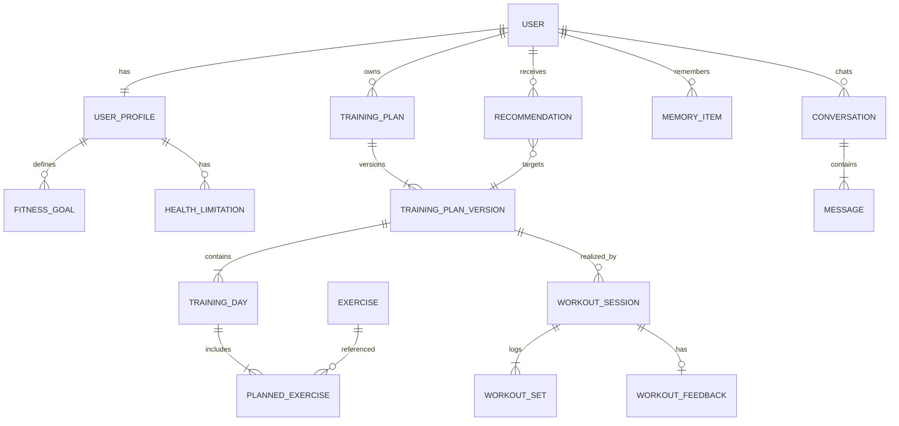

# Domain Model — Core MVP

| Field | Value |
| --- | --- |
| Owner | Engineering (Architect) |
| Version | 0.1 |
| Status | `PROPOSED` (PH00-M02) |
| Related | AUTH-003 §3, AIR rules, PH00-TB-008 |
| Note | Conceptual/logical model — **no** ORM/migrations in M02 |
| Pending | Numerical fitness thresholds (expert); content licensing |

## 1. Modelling style

| Kind | Use |
| --- | --- |
| Aggregate root | Consistency boundary / transaction |
| Entity | Identity within aggregate |
| Value object | Immutable attributes (GoalType, Weight, TimeWindow) |
| Domain service | Fitness Engine policies (stateless wrt persistence) |
| Application service | Use-case orchestration, authZ, unit of work |

## 2. Aggregates (Core MVP)

### User (Identity)

- **Root:** User
- **Entities:** ConsentRecord
- **VOs:** Email, ExternalIdentityRef
- **Lifecycle:** active → deletion_requested → deleted
- **Invariants:** one primary identity subject; deletion is irreversible process
- **Sensitivity:** PII
- **Deletion:** triggers cascade commands to other contexts

### UserProfile (Profile)

- **Root:** UserProfile (userId)
- **Entities:** FitnessGoal, HealthLimitation, FitnessAssessment
- **VOs:** UserPreference, BodyMetrics, ExperienceLevel, EquipmentSet, Availability
- **Invariants:** goals ⊆ approved set {muscle, strength, general_fitness, basic_weight_loss}; limitations tagged not diagnosed
- **Sensitivity:** health-adjacent
- **Notes:** AI MemoryItem is **not** SoT for goals/limitations

### Exercise (Catalog)

- **Root:** Exercise
- **VOs:** MuscleGroup refs, Equipment, Instruction, MediaRef, ContraindicationTag, SubstitutionGroupId
- **Entities:** —
- **Invariant:** only `approved` exercises appear in activated plans
- **Sensitivity:** generally non-PII; licensing pending
- **Review:** ContentReviewStatus

### TrainingPlan (Training)

- **Root:** TrainingPlan
- **Entities:** TrainingPlanVersion, TrainingDay, PlannedExercise, PlanAdjustmentProposal
- **VOs:** Schedule, RestDayPolicy
- **Invariants:**
  - At most one Active version per user plan
  - Activated versions immutable
  - PlannedExercise.exerciseId ∈ approved catalog
  - Activation requires user confirmation + Validated version
- **Sensitivity:** low–medium
- **Concurrency:** optimistic version / row version on plan header

### WorkoutSession (Workout)

- **Root:** WorkoutSession
- **Entities:** WorkoutExercise, WorkoutSet, WorkoutFeedback
- **VOs:** Performance metrics
- **Invariants:**
  - References immutable `trainingPlanVersionId`
  - Sets append-only for committed history
  - Client `event_id` unique per user for sync
- **Sensitivity:** health-adjacent performance
- **Offline:** local aggregate mirror; sync via events

### RecoveryCheckIn / BodyMeasurement

- Separate small aggregates owned by Recovery / Progress
- Do not rewrite workout sets

### Conversation & Recommendation (Coaching)

- **Conversation** root with Message entities
- **MemoryItem** aggregate: provenance, confidence, status, editable/deletable; cannot override Profile/Training SoT
- **Recommendation** aggregate: proposal payload, target plan version, expiry, state
- **AIUsageRecord:** append-only metering

### NotificationPreference

- Per-user preference aggregate; quiet hours etc.

### Platform

- BackgroundJob, OutboxEvent, AuditRecord — infrastructure aggregates with clear ownership in Platform module

## 3. Relationship diagram

## 4. Domain events (limited)

| Event | Publisher | Purpose |
| --- | --- | --- |
| training.plan_activated | Training | Reminders, coaching context refresh |
| training.plan_updated | Training | Schedule changes |
| workout.completed | Workout | Progress projection, coaching |
| user.deletion_requested | Identity | Cascaded deletion |
| recommendation.accepted | Coaching | Hand-off to Training apply |

Prefer direct application calls inside a process when both sides are in-proc; outbox when durability across worker/API required.

## 5. Explicit non-goals

- No invented 1RM formulas, calorie deficits, or medical thresholds
- No Nutrition aggregates in Core MVP
- No social graph

## 6. Validation

M02 review; refine during M03 schema design; expert rules M04.
