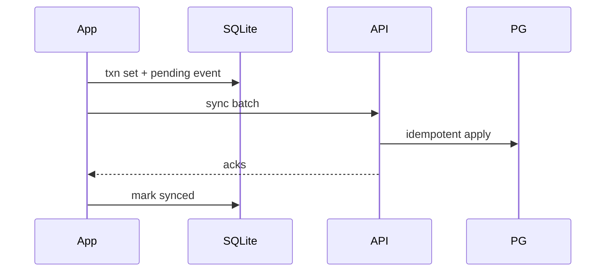

# Offline-First Workout Architecture (Conceptual)

| Field | Value |
| --- | --- |
| Owner | Engineering (Mobile + Backend) |
| Version | 0.1 |
| Status | `PROPOSED` (PH00-M02) |
| Related | AUTH-003 §5, WKT-010/011, PH00-M06 |
| Note | Design only — no Drift/API implementation in M02 |

## 1. Goals

- Start/log/timer/complete/resume workouts without network
- Survive process death
- Sync without duplicate committed sets or silent loss
- Preserve original plan version references
- Isolate accounts

## 2. Local persistence (proposed)

- Drift/SQLite stores: session, exercises, sets, feedback, **pending_events**
- **Atomic transaction:** mutate session/set + insert pending event
- Client-generated UUIDs for session and `event_id`

## 3. Pending event model (example fields)

`event_id`, `event_type` (e.g. `workout.set_logged`), `entity_id`, `client_sequence`, `occurred_at`, `payload`, `sync_status`

## 4. Sync protocol (proposed)

1. Authenticate
2. Upload pending batch ordered by `client_sequence`
3. Server dedup on `(user_id, event_id)`
4. Apply once; ack list
5. Client marks Synced; backoff on failure

## 5. Required invariants

| ID | Invariant |
| --- | --- |
| OFF-1 | Business state ≠ sync state |
| OFF-2 | Completed local workout not lost on restart |
| OFF-3 | Duplicate event_id → no duplicate sets |
| OFF-4 | History references original plan version |
| OFF-5 | Logout warns if unsynced; switch account cannot read other pending |
| OFF-6 | Deletion request stops sync and purges local |

## 6. Open decisions (M06)

- Multi-device concurrent edit of same session
- Max pending queue / storage pressure
- Exact conflict resolution algorithm
- Whether plan activation requires online (proposal: **yes** for MVP)

## 7. Non-goals

- Offline AI generation
- Offline catalog admin
- Implementing sync in M02

## 8. Validation

PH00-M06 POC: airplane mode, process death, duplicate/out-of-order, account switch, version preservation.
