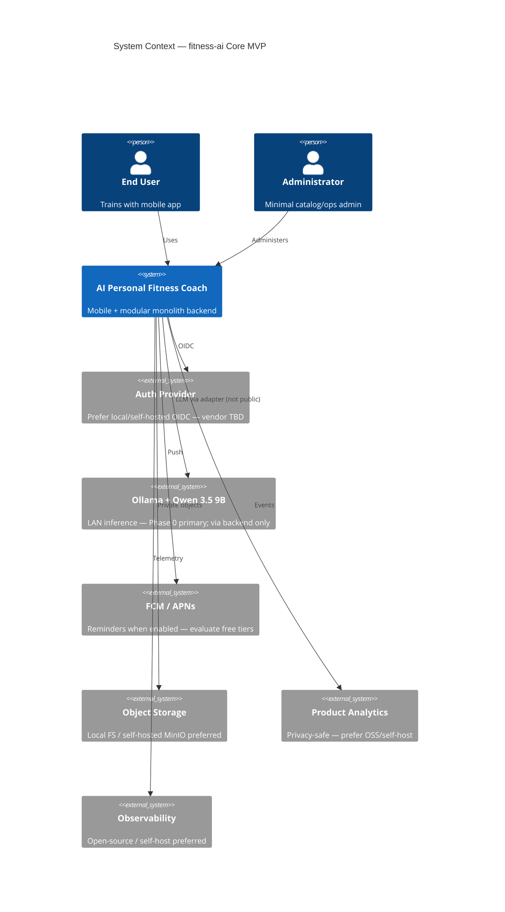
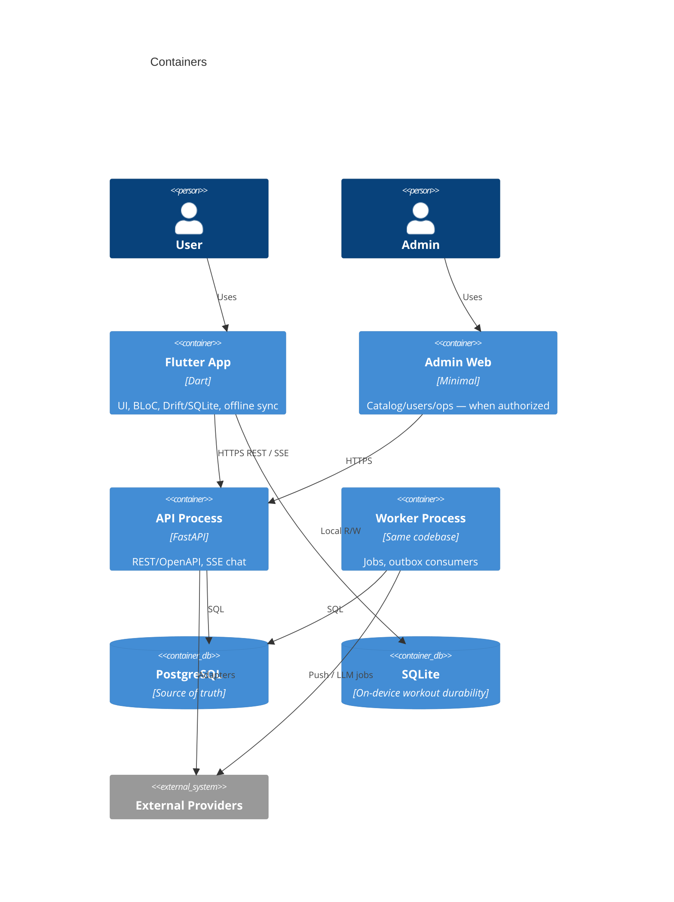
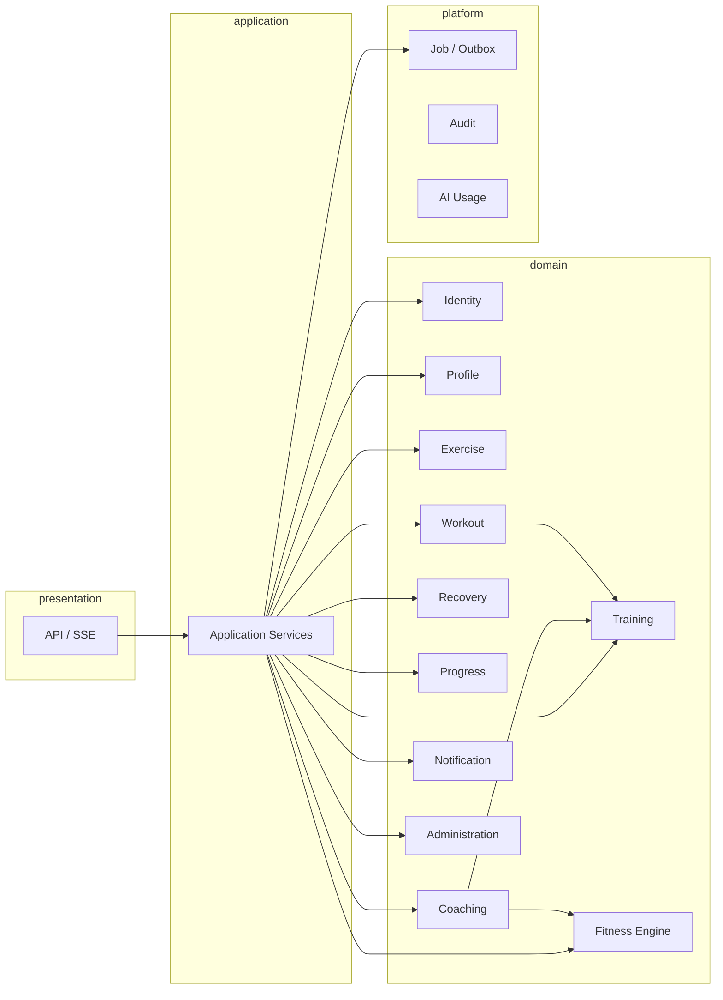
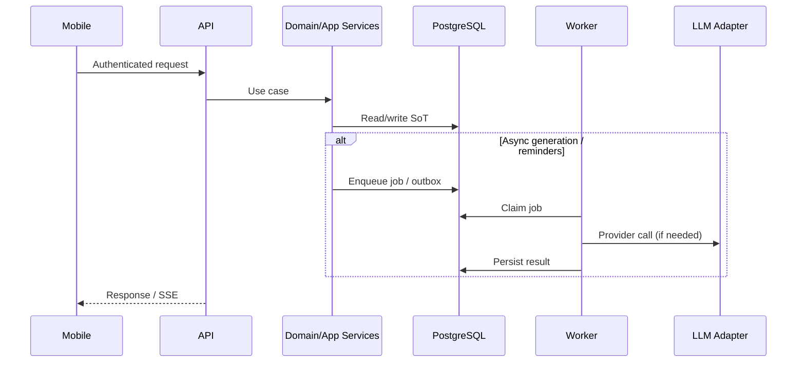

# System Architecture — Core MVP

| Field | Value |
| --- | --- |
| Owner | Engineering (Architect) |
| Version | 0.1 |
| Status | `PROPOSED` (PH00-M02) |
| Related | AUTH-003, ADR-0001..0015, PH00-TB-008 |
| Assumptions | Zero-Cost First (ADR-0017); Ollama for Phase 0 AI; PG job queue subject to M07; production hosting pending |
| Open decisions | Auth provider (prefer self-hosted/free); analytics (OSS); production AI hosting; multi-device conflict; Qwen suitability |

## 1. Scope

Architecture for Core MVP: auth/onboarding, exercise catalog, personalized plans with immutable versions, offline-first workouts, AI coach with structured memory and recommendation cards, basic adaptive coaching, progress, reminders, minimal admin, security/privacy/AI safety.

## 2. System context

| Actor / system | Status |
| --- | --- |
| Flutter mobile | Confirmed |
| FastAPI modular monolith + worker | Confirmed shape; bootstrap M03 |
| PostgreSQL (local/Docker) | Confirmed |
| Local SQLite (Drift) | Confirmed |
| GitHub + GitHub Actions | **ACCEPTED** (ADR-0001); stay within **free** limits / self-hosted runners if needed |
| Ollama (Qwen 3.5 9B) | **Approved development AI** (ADR-0017); suitability **PENDING** POC |
| Auth / analytics / object storage | Prefer zero-cost/self-host; paid requires PO approval |
| FCM/APNs | When notifications required; check free tier limits |
| Minimal admin web | Confirmed need; OSS stack |
| Production cloud hosting | **PENDING** PO decision |

## 3. Container architecture

**Trade-off:** API and worker are separately deployable processes from one modular monolith codebase — not microservices.

## 4. Backend module map

**Rules:** Domain modules do not import infrastructure. No cross-module repository access. Cross-context collaboration via application services / explicit events (limited outbox).

## 5. Core runtime interactions

## 6. Trust & deployment boundaries

| Boundary | Notes |
| --- | --- |
| Device | Local SQLite; secrets in secure storage; no other-user data |
| TLS edge | Mobile/admin → API |
| AuthN/Z | OIDC tokens; ownership checks on every mutation |
| Provider edge | LLM/auth/push/storage via adapters; no raw PII in analytics; **backend-only** Ollama |
| Data plane | PostgreSQL authoritative for server state |
| Cost plane | Local/zero-cost first; production hosting **PENDING** (see ADR-0017) |

Full local vs production split: [`ZERO_COST_DEPLOYMENT_BOUNDARIES.md`](ZERO_COST_DEPLOYMENT_BOUNDARIES.md).

Environments: local / staging / prod separation (M03+). No production health data in nonprod.

## 7. Sync vs async

| Sync | Async (jobs / limited outbox) |
| --- | --- |
| Profile reads/writes, workout sync batch ack, plan activate, recommendation accept | Plan generation, reminder fan-out, deletion workflows, heavy AI generation |

Job implementation **PROPOSED** PG durable queue — validate M07.

## 8. Failure isolation

- Provider outage: existing plans/workouts remain usable; AI degraded UX.
- Worker crash: lease/retry (M07).
- Mobile offline: local durability (M06).
- Invalid AI output: reject/repair/fallback; never activate unvalidated plans.

## 9. Validation requirements

Walkthroughs in `DESIGN_WALKTHROUGHS.md`. M03 walking skeleton. M05–M07 POCs for AI/offline/jobs.
