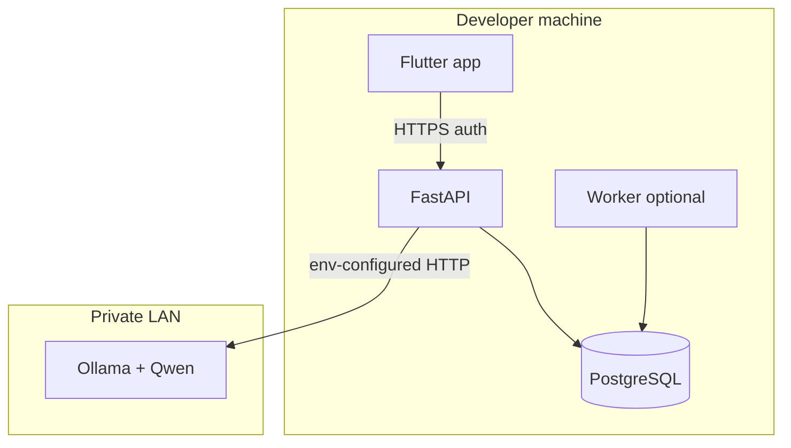

# Zero-Cost Deployment Boundaries

| Field | Value |
| --- | --- |
| Owner | Engineering |
| Version | 0.1 |
| Status | `IMPLEMENTED` (design; F-M02-005) |
| Related | ADR-0017, COST_AND_PROVIDER_GOVERNANCE.md |
| Note | No connectivity tests or model benchmarks in M02 |

## 1. Local development (authorized shape)

| Component | Role | Cost |
| --- | --- | --- |
| Flutter SDK / IDE | Mobile development | Local / free |
| FastAPI backend | API + AI gateway | Local OSS |
| PostgreSQL | Server SoT (Docker Engine or local install) | Local |
| SQLite / Drift | Offline workout durability on device/emulator | Local |
| Ollama on LAN | LLM inference | **Zero** (existing PO hardware) |
| Qwen 3.5 9B | Initial POC model (tag **unverified**) | Zero |
| Optional local worker process | Jobs/outbox consumer | Local same codebase |
| Env files (local, gitignored) | `OLLAMA_BASE_URL`, `OLLAMA_MODEL`, DB URLs | Secrets stay local |
| Paid cloud services | **None** | Forbidden without PO |

## 2. Trust boundaries

| Boundary | Rule |
| --- | --- |
| Mobile ↔ Backend | Authenticated HTTPS only |
| Backend ↔ Ollama | Server-side adapter only; **no** mobile→Ollama |
| Ollama exposure | **Not** public internet; private LAN / host firewall |
| Config | Base URL + model tag via **environment variables**; never hardcode LAN IP in application source |
| Docs vs runtime | Documented example host (e.g. reported LAN URL) is **ops documentation**, not committed runtime config |
| Paid fallback | **No** automatic failover to OpenAI/Anthropic/Gemini |
| AI down | Workouts/offline continue; AI degraded UX |
| CI runners | **Do not assume** GitHub-hosted runners can reach private LAN Ollama |

## 3. Failure handling (design)

- Connection timeout / unreachable Ollama → structured error; deterministic fallbacks where defined; no paid retry path
- Offline workouts independent of AI availability
- Local hardware CPU/GPU/RAM constraints acknowledged (R-022)
- Early AI POCs use **synthetic** data only

## 4. Local integration testing strategy

| Layer | Where | Notes |
| --- | --- | --- |
| Unit | Dev machine | Domain/Fitness Engine/pure functions |
| API smoke | Local Compose/process | No cloud |
| AI adapter | Dev machine **on LAN** to Ollama | M05; not GitHub-hosted runner unless self-hosted runner on LAN |
| Offline sync | Emulator/device | M06 |
| Jobs | Local worker + PG | M07 |

## 5. Production

| Topic | Status |
| --- | --- |
| Hosting | **PENDING** |
| Capacity / HA | **PENDING** |
| Security & availability SLOs | **PENDING** |
| Operational cost | **PENDING** (any paid spend needs PO) |
| Model suitability | **PENDING** M05+ evidence |
| Ollama vs other inference | **PENDING** after POC; paid cloud AI needs PO approval |

## 6. Explicit non-actions in M02

No AI integration execution, no model benchmarks, no `.env` committed, no Docker/app bootstrap.
