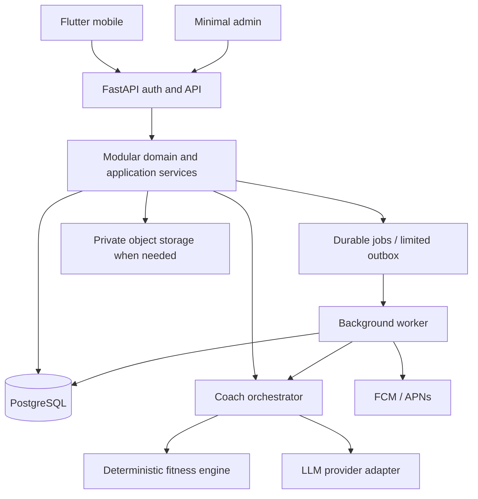

# Technical Implementation Plan v1.1 — Consolidated reconstruction

Status: PROPOSED replacement baseline pending ratification. Historical PO/TL alignment, not verbatim. Explicit owner approval of GitHub + GitHub Actions is already effective; other planning choices retain their stated status. No POC or benchmark is claimed completed.

## 1. Scope and authorization
Core MVP follows Product Plan and PO Review. GO only for authorized Phase 0 tasks; current milestone PH00-M01 remediation. M02+ NO-GO until M01 acceptance and explicit authorization. Full MVP NO-GO until Phase 0 exit. Alpha week 8 and beta week 16 are planning targets. Nutrition Lite conditional P1, separate spike/estimate; no running, social, wearables, full nutrition or production payments in MVP.

## 2. Architecture and stack
Planning direction: Flutter Clean Architecture (pragmatic), BLoC/Cubit, GoRouter, GetIt, Dio, Drift/SQLite; Python FastAPI modular monolith, SQLAlchemy, Alembic, Pydantic, PostgreSQL. REST/OpenAPI, SSE chat, async plan jobs. Managed OIDC provider pending POC. OpenAI adapter candidate subject to governance/POC, provider abstraction. S3-compatible storage as required, FCM/APNs for reminders, minimal web admin (Next.js candidate), Sentry/basic OpenTelemetry, Docker and managed containers. GitHub repository + GitHub Actions + PRs explicitly approved (ADR-0001/D-001); workflow implementation M03, no remote configuration authorized now. Analytics provider pending. PostgreSQL durable queue proposed subject to reliability POC; Redis/Celery fallback only via ADR. Defer microservices, Kubernetes, Kafka, generic event platform, multi-agent, vector database, custom RAG, Terraform unless justified.



API and worker separately deployable from same codebase. Modules identity, profile, exercise, fitness, training, workout, coaching, recovery, progress, notification, administration. Nutrition/subscription/social only when authorized. Domain independent of frameworks/LLM; application interfaces/events across modules, no direct cross-module repository access. Avoid speculative abstractions. Fitness engine is deterministic domain service, not separate deployment.

Target repository (design M02, bootstrap M03): AGENTS.md, README.md, .github/workflows/, .env.example, .cursor/rules/, apps/mobile/, apps/admin/ when needed, services/backend/, ai/prompts/, ai/schemas/, ai/evaluations/, infrastructure/, scripts/, tests/, docs/. Preserve existing docs/phase-00 structure. Backend module domain/application/infrastructure/presentation; Flutter feature data/domain/presentation with shared core/network/database/sync/security/design system, app/router/DI. No empty future modules merely for symmetry.

## 3. Domain and data
Conceptual ownership, to refine M02:
| Module | Authoritative records |
|---|---|
| Identity | users, devices, consents, account deletion |
| Profile | profile, goals, preferences, assessments, limitations |
| Exercise | exercises, muscle groups, media, review status |
| Training | plans, versions, days, planned exercises |
| Workout | sessions, sets, workout feedback |
| Recovery | check-ins, transient recovery observations |
| Coaching | conversations, messages, memory, recommendations |
| Progress | body measurements, derived metrics, PRs |
| Notification | preferences, scheduled jobs |
| Operations | outbox, audit, AI usage, admin roles |

Future subscriptions/entitlements/payment events only as justified. UUID offline IDs, UTC timestamps + user timezone, constraints, optimistic concurrency, migrations. Data ownership and deletion boundaries explicit; derived progress is not source of workout truth.

Exercise schema: ID, name, primary/secondary muscles, equipment, difficulty, movement pattern, exercise type, instructions, contraindication tags, substitution group, media references, review status. Only approved IDs in activated plans. Target 50–100 reviewed exercises; licensing/expert approval pending.

Training plan lifecycle: Draft → Validated → Active → Superseded → Archived; rejection branch. Atomic activation and supersession; immutable active version, history references original version. Recommendation lifecycle Proposed → Validated → Accepted/Rejected/Expired → Applied (failure explicit); revalidate ownership, safety and current version before apply. Workout business state planned/in-progress/completed/abandoned separate from sync state. Exact transitions/invariants M02.

## 4. Fitness engine and AI
V1: ExerciseSelector, TrainingTemplate, SchedulePolicy, TrainingVolumeCalculator, IntensityPolicy, SafetyPolicy, SubstitutionPolicy, RecoveryPolicy, TrainingPlanValidator; basic ProgressionPolicy P1 after expert approval. Pure functions/simple services; Strategy only where useful. Advanced periodization, fatigue modeling and endurance deferred. Numerical thresholds not approved.

Generation: profile/goal → constraints → approved template → eligible exercises → LLM personalization → schema validation → deterministic fitness/safety validation → draft → user confirmation → active. Bounded repair; vetted fallback or reject/clarify. No unvalidated plan activation.

Single orchestrator: normalize → intent → context → safety → authorized tools/engine/LLM → output validation → response/proposal → audit/eval/usage. Deterministic fast path for explicit commands, LLM for conversation/motivation, hybrid for generation/review/adjustment. No LLM direct DB writes. Server scopes tools by authenticated user, validates args, timeout/idempotency/audit; never trust model-supplied user ID. Read profile/goals/plan/history/recovery/catalog; compute volume; draft plan/proposal; controlled preference update; activation only confirmed application command.

Structured response example:
```json
{"response_id":"example","message":"Review your proposed adjustment.","cards":[{"type":"training_adjustment","title":"Review adjustment","proposal_id":"example-proposal","reason":"Recent feedback","requires_confirmation":true}],"actions":[{"type":"review_proposal","reference_id":"example-proposal"}],"safety_status":"passed"}
```
Allowlisted card/action types only; no arbitrary executable code or endpoint. Stream safe text with appropriate safety control; release actions only after validation. AI at onboarding, Today, pre/post workout, next workout, chat and progress; during workout deterministic guidance, no LLM call per set.

Memory: current conversation, authoritative profile/goals, validated preferences, derived performance, transient feedback, AI summaries. Structured PostgreSQL first; semantic retrieval deferred. Record provenance, timestamps, status, confidence and retention. Hypothetical statements not facts; inferred injury not diagnosis; explicit goal confirmation; fatigue time-sensitive. User view/edit/delete memory; deleting memory is distinct from deleting authoritative history. Account deletion covers derived data. Context builder uses current authoritative records.

Failure UX: retry timeout, existing plan usable during outage/quota, bounded repair/fallback, clarify missing data, block unsafe output, refresh stale proposal, resolve memory conflict against domain truth. Transparent quota. No extreme dieting or medical diagnosis; abnormal pain safety guidance. Prompt injection and tool authorization tests.

## 5. Offline and contracts
Drift transaction persists session/set and pending event atomically. Cached plan, start/log/timer/resume/complete offline. Sync batch authenticated; UUID event ID + user scope dedup, client sequence, version, retry/backoff, server acknowledgement. Example event fields event_id, event_type=workout.set_logged, entity_id, client_sequence, occurred_at, payload(session_id,exercise_id,set_number,reps,weight_kg). Preserve original plan version. Account isolation, logout unsynced warning, deletion stops sync. New device sees synced data only. Multi-device conflict policy pending POC/M02 design. No offline AI promise.

Proposed API contracts (not implemented): GET /v1/me; PATCH /v1/me/profile; POST /v1/fitness/assessments; GET /v1/exercises; POST /v1/training/plans/generate; GET /v1/jobs/{id}; GET /v1/training/plans/active; GET /v1/training/plans/{id}; POST /v1/training/plans/{id}/activate; POST /v1/training/plans/{id}/adjustments; POST /v1/workouts/sessions; POST /v1/workouts/sync; GET /v1/workouts/history; GET /v1/progress/summary; POST /v1/recovery/checkins; POST /v1/coach/conversations; POST/GET /v1/coach/conversations/{id}/messages; GET /v1/me/entitlements (P1); DELETE /v1/me/account. OpenAPI and DTO mapping; contract review before implementation.

Limited transactional outbox for training.plan_activated/updated → reminders, workout.completed → progress, user.deletion_requested → deletion where durability needed. At-least-once delivery, idempotent consumers, bounded retry and failure visibility. PG job POC: atomic claim, leases/fencing, concurrent workers, crash recovery, cancellation, retry exhaustion, no duplicate committed effects. No generic broker platform.

## 6. Security, privacy and operations
OIDC, secure mobile storage, TLS, ownership checks, RBAC/admin MFA, rate limits, validation, private storage/signed URLs, encryption, audit, secret/SCA/SAST scans, data minimization. No raw health/chat in logs or analytics. Consent versioning, export/access, deletion including memory/media/derived data and backup retention policy. Target jurisdiction, legal basis, provider retention/training/residency and data classification pending; synthetic data only before governance approval. HIPAA not assumed applicable.

Local/dev/staging/prod separation; no production health data in nonprod. GitHub Actions PR lint/format/unit/security/integration/build/smoke, AI smoke and later full evaluation; deployment approval and branch protection subject to implementation/hosting capability. Proposed SLOs: 99.9% monthly availability, non-AI p95 ≤500ms, error <1%, AI TTFT p95 ≤3s, queue <30s normal, RPO 1h/RTO 4h. Validate before commitment. Managed DB backups/PITR, restore drills, alerts, runbooks. Usage metadata, quota, global budget, concurrency, circuit breaker, model routing/context compression/caching; no actual cost benchmark. Historical illustrative cost: 1000 DAU × 10 chats/day × $0.003 × 30 + 1000 × 3 scans/day × $0.01 × 30 + $300 infra = $2,100/month; hypothetical inputs, scans deferred, not vendor pricing.

## 7. Delivery plan
| Slice | Target weeks | Demonstrable outcome |
|---|---|---|
| 0 | 1–2 | Prototype, walking skeleton, POCs, governance |
| 1 | 3–6 | Auth/onboarding, catalog, personalized validated plan/version |
| 2 | 5–8 | Today, workout, offline persistence/sync, feedback |
| 3 | 7–10 | Coach chat/cards/context/tools/memory |
| 4 | 9–12 | Adaptive proposal, accept/reject, recovery/version concurrency |
| 5 | 11–14 | Progress/reminders/minimal admin |
| 6 | 13–16 | Security/eval/perf/accessibility/beta hardening |

S0 concept; S1 onboarding; S2 catalog/plan/versioning; S3 workout/offline/basic coaching; S4 full chat/tools/memory; S5 adjustment; S6 progress/reminders/admin; S7 beta. Explicit basic post-workout coaching deliverable by week 8; external alpha only after safety gate. Parallel work assumes staffing. Critical path feasibility → domain/catalog → plan → workout/offline → coaching/adaptation → eval/beta.

### Phase 0 execution
Current repository greenfield per agent report, not independently verified. Nine milestones adopted for agent execution; existing repository task IDs control. Proposed 10 working days with parallel roles, extension up to one week only approved.
| Milestone | Target | Deliverable / gate |
|---|---|---|
| PH00-M01 | Day 1 | Baseline, AGENTS, backlog, risk/decision registers, validation, TL acceptance |
| PH00-M02 | Days 2–3 | Context/container/domain/ownership/lifecycle/AI/repo architecture and ADRs |
| PH00-M03 | Days 3–5 | Flutter/FastAPI/PG/migrations/local CI/staging walking skeleton |
| PH00-M04 | Days 3–5 | Catalog schema/templates/constraints/content rights and expert review |
| PH00-M05 | Days 4–8 | Generation, structured output, memory, streaming, safety, cost/latency POCs |
| PH00-M06 | Days 5–8 | Offline persistence/restart/sync/idempotency/conflicts POC |
| PH00-M07 | Days 5–8 | Durable job reliability POC |
| PH00-M08 | Days 2–9 | Threat model, privacy/provider governance, evaluation dataset/harness |
| PH00-M09 | Day 10 | Evidence, ADR updates, traceability, role estimate, joint exit |

These are indicative parallel windows, not authorization to bypass sequential milestone gates. Re-estimate if sequential/single developer. M01 current; M02+ not authorized. Each task unique ID, parent milestone, feature link when applicable, priority, dependencies, deliverable, AC, owner/reviewer/status. Reconcile existing 18 task IDs before expanding; do not reuse IDs from earlier illustrative tables. Preserve PO feature IDs. Use EPIC/FEAT/US/TASK/SPIKE/TEST/EVAL/ADR/RISK/CR namespaces; no silent renumbering. Example feature links ONB-009→plan generation, AI-004→memory, AI-007→generation, AI-008→adjustment, AI-010→safety, TRN-008→substitution, TRN-010→versioning, WKT-010→offline, WKT-011→resume, REC-001→feedback. Actual task IDs assigned after reconciliation.

### POC acceptance
- Generation: proposed ≥50 scenarios, structured output, approved IDs/hard constraints, safe fallback/reject; expert review.
- Memory: explicit preference, hypothetical/transient/conflict, isolation, deletion.
- Offline: airplane mode, process death, timeout, duplicate/out-of-order, account switch, original version, conflict policy.
- Jobs: concurrent claims, crash, lease expiry/fencing, cancellation, bounded retry, authorization, no duplicate commit.
- Cost/latency: measure input/output tokens, p50/p95 TTFT/total, cost per feature/model, repair/failure rate and context growth; report actual evidence.

## 8. Estimate and capacity (ROM only)
| Workstream | Person-days |
|---|---:|
| Architecture | 22–32 |
| Foundation | 14–22 |
| UI/UX | 28–42 |
| Auth/profile | 15–25 |
| Fitness/catalog | 22–35 |
| Training | 25–40 |
| Workout/offline | 35–55 |
| AI | 45–70 |
| Progress/reminders | 15–25 |
| Admin | 6–12 |
| Analytics | 5–8 |
| QA | 35–50 |
| Security/DevOps | 18–28 |
| Core total | 285–444 |

Nutrition Lite extra 23–36 PD: rules 3–5, BE 5–8, Flutter 7–10, AI 2–4, design 2–3, QA 4–6. Combined 308–480. Excludes PO/expert/content licensing and ongoing operations. Illustrative 7 FTE × 16 × 5 × 75% = 420 PD. Role capacity TL60, Flutter120, BE90, AI60, QA60, design30. Illustrative demand 45/100/82/58/48/32 =365 PD; design bottleneck, AI/BE near capacity. 15% contingency =419.75 PD, essentially all capacity. At $25/h ×8h = $83,950 illustrative, not approved budget. Re-estimate by role and critical path after POCs. Earlier full-product ROM 980–1520 PD not commitment.

## 9. Quality and release gates
pytest real DB, Flutter unit/bloc/widget/integration, contract, fault, migration, load, security, AI regression. Proposed coverage domain90%, application80%, critical AC100%. Eval dataset → execute → schema/rules → supplemental LLM judge → expert → report. Proposed targets schema≥99% after repair, hard constraints100%, zero invalid activated IDs/critical safety/unauthorized tools in suite, expert quality≥85%, memory≥95%, TTFT p95≤3s. No measured results yet. Zero committed loss/duplicate effects in fault suite; no unresolved release-blocking high/critical security; consent/access/deletion, monitoring, accessibility and no critical UX blockers. Product metrics hypotheses separate from hard safety gates.

G0 scope PO/TL; G1 feasibility TL; G2 rules PO/expert; G3 prototype PO/design; G4 alpha PO/TL/QA; G5 AI safety TL/AI/expert; G6 beta PO/TL/QA; G7 commercial PO/TL/sponsor. Applicable G5 safety checks precede any external G4 alpha regardless of numbering. DoR: requirement, AC, dependencies, UI/API, estimate, authorization. DoD: implementation, tests/evidence, review, security, analytics, docs, AC; acceptance by reviewer only.

Phase 0 exit: scope/persona/market/prototype/hypotheses; architecture/domain/ADRs/walking skeleton; AI generation/fitness validation/memory/offline/jobs/cost evidence; expert rules/content rights/eval dataset/safety; threat/provider/classification/consent/deletion; traceability/resources/re-estimate/Sprint1 DoR/joint Go-NoGo. Missing mandatory evidence blocks dependent work. Independent remediation may continue.

## 10. ADR and governance
ADR topics: Flutter, modular monolith, monorepo, PG, managed auth, hybrid AI, structured memory, offline, immutable versions, PG queue, limited outbox, provider abstraction, health governance, eval, analytics, content rights, Nutrition Lite, entitlement. Existing ADR-0001 reserved for approved GitHub/Actions; allocate unique IDs from repository, not historical illustrative numbering. Provider/queue/licensing/governance/analytics decisions pending evidence. D-005 accepted with constraints: AGENTS project-specific engineering instructions, no override of system/security/tool permissions, no global Cursor edits, report unresolved conflicts.

Docs required during Phase 0: product vision/scope/backlog, system architecture/domain/fitness rules/AI architecture/security baseline/technical backlog/traceability/phase plan/risk/ADR register/AGENTS. Offline sync design before Slice2, memory design before Slice3, deployment runbook before beta. Reuse existing structure, avoid duplicate authority. Agent reads docs → plans scoped task → implements/tests → reports evidence/assumptions/blockers → independent review → explicit acceptance. No unapproved dependencies, scope/schema/architecture changes, destructive actions, real health data, commit/push/merge. Status NOT_STARTED/IN_PROGRESS/BLOCKED/IMPLEMENTED/VALIDATED/ACCEPTED/DEFERRED; only reviewer accepts.

Risks: unsafe plans/advice, offline loss, privacy leak critical; content rights, missing expert, cost, provider policy, bottlenecks, scope, usability/retention high; queue feasibility/Nutrition Lite medium. Owners TL/AI/QA for technical safety, PO/expert rules/content, PO/design value, sponsor resources. Later spikes nutrition accuracy/rights, billing receipts/webhooks/restore, HealthKit/Connect permissions/dedup, social moderation, running GPS/battery, Garmin/WHOOP access. All remain unverified.
